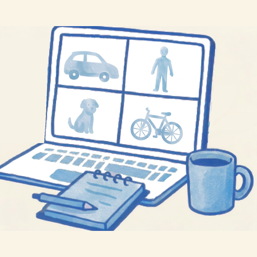

# DOOODS2 — расширенная версия

  

DOOODS2 сохраняет идею оригинального сервиса: локально распознавать объекты на изображениях и видеопотоке. Эта независимая версия делает повседневную работу с камерами удобнее и теснее связывает распознавание с Home Assistant.

- Отдельные профили и зоны распознавания для камер.
- Запуск анализа по движению, чтобы не обрабатывать кадры без необходимости.
- Более наглядные размеченные изображения и удобное управление камерами.
- Поддержка защиты доступа к сервису.
- **Экспериментальная функция** - определение лиц в кадре и поиск совпадений с зарегистрированными в базе эталонами.

Проект развивается независимо от оригинального [DOODS2](https://github.com/snowzach/doods2) и не является его официальной версией или аффилированным продуктом авторов оригинала.

## Диагностика лиц

В конфигурации App `face.enabled` управляет всей функцией лиц;
`face.diagnostics_enabled` отдельно управляет диагностикой и по умолчанию
включён, в том числе для существующих конфигураций. Изменения применяются
после перезапуска App.

При `face.enabled: true` и `face.diagnostics_enabled: false` распознавание
по-прежнему использует загруженную в память галерею и передаёт результаты
интеграции. Диагностические кадры, кропы, буфер совпадений и журнал не
записываются; ранее сохранённые данные не удаляются. Просмотр диагностики,
редактирование, экспорт и импорт галереи через API закрыты до повторного
включения диагностики. Настройка камер интеграцией продолжает работать.
Страница Faces показывает только количество людей и эталонов и состояние
моделей, без имён и изображений. Готовность моделей не подтверждает, что
кадры действительно обрабатываются.

Сводка требует аутентифицированного Supervisor Ingress с заголовком
пользователя или прямого API-запроса с `doods-auth-key`; если Supervisor не
передал идентификатор пользователя, сводка вернёт 401. Возможность
`face_gallery` оставлена для совместимости с настройками камер интеграции
и при выключенной диагностике не означает доступность API галереи.
