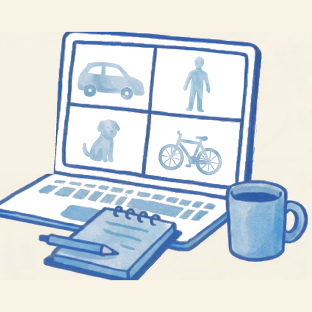

> **Кандидат для проверки.** Безопасность Ingress и конкурентность не подтверждены на живом HA. Не используйте реальные биометрические данные до проверки. Slug dev изменён на `dooods2-dev`: Supervisor может распознать его как новое приложение. Настройки, API-ключ и данные галереи автоматически не переносятся; перед установкой сохраните резервную копию и не удаляйте старый App до проверки.

# DOOODS2 — расширенная версия

  

DOOODS2 сохраняет идею оригинального сервиса: локально распознавать объекты на изображениях и видеопотоке. Эта независимая версия делает повседневную работу с камерами удобнее и теснее связывает распознавание с Home Assistant.

**Экспериментальный App: 0.1.38.5-dev. Только для изолированного стенда.**

Лимиты на процесс: 16 WebSocket `/detect`, 8 WebSocket `/stream`, 32 WebSocket и 32 работающих worker для `/motion/stream`. При занятом лимите новое соединение отклоняется; зависший нативный RTSP worker удерживает слот до возврата. Для систем с более чем 32 RTSP-камерами этот кандидат не подходит без пересмотра лимита.

- Отдельные профили и зоны распознавания для камер.
- Запуск анализа по движению, чтобы не обрабатывать кадры без необходимости.
- Более наглядные размеченные изображения и удобное управление камерами.
- Поддержка защиты доступа к сервису.
- **Экспериментальная функция** — определение лиц в кадре и поиск совпадений с зарегистрированными в базе эталонами.
- **Экспериментальная функция** — программная компенсация освещения лица перед сравнением.

Компенсация по умолчанию выключена и применяется к выровненному изображению лица, а не к целому кадру. Исходный кадр и эталоны не изменяются. Качество распознавания и вероятность ложных совпадений необходимо проверить на своей системе.

Проект развивается независимо от оригинального [DOODS2](https://github.com/snowzach/doods2) и не является его официальной версией или аффилированным продуктом авторов оригинала.

# Установка DOOODS

В репозитории два компонента, и оба ставятся с одного и того же адреса:

- **интеграция** `custom_components/dooods/` — в Home Assistant, через Marketplace или HACS;
- **приложение** `local_apps/dooods2/` — в магазин приложений Home Assistant.

Адрес репозитория: `https://github.com/S0ft0r/ha-dooods`

---

## Интеграция

### Marketplace (Home Assistant 2026.11 и новее)

1. Открыть ссылку:

2. Home Assistant предложит добавить репозиторий — согласиться.
3. Нажать «Установить».
4. Перезапустить Home Assistant.
5. **Настройки → Устройства и службы → Добавить интеграцию → DOOODS**.

### HACS (2026.10 и старше)

1. **HACS → Интеграции → ⋮ → Пользовательские репозитории**.
2. Вставить `https://github.com/S0ft0r/ha-dooods`, тип — **Integration**, нажать «Добавить».
3. Найти DOOODS в списке и установить.
4. Перезапустить Home Assistant.
5. **Настройки → Устройства и службы → Добавить интеграцию → DOOODS**.

---

## Приложение DOOODS2

1. Открыть ссылку:

**или**

1. **Настройки → Приложения → Магазин приложений**.
2. ⋮ → **Репозитории**.
3. Вставить `https://github.com/S0ft0r/ha-dooods` и нажать «Добавить».
4. В магазине появится раздел **DOOODS** с приложением **DOOODS2**.
5. Установить, запустить, открыть страницу **faces** из бокового меню или через Ingress.

Приложение собирается локально из `Dockerfile` — на Raspberry Pi первая установка занимает несколько минут.

---
